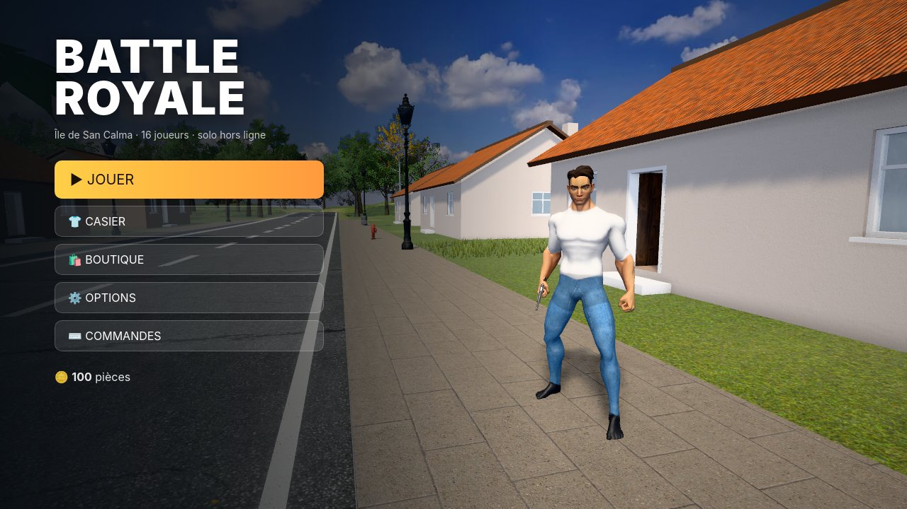
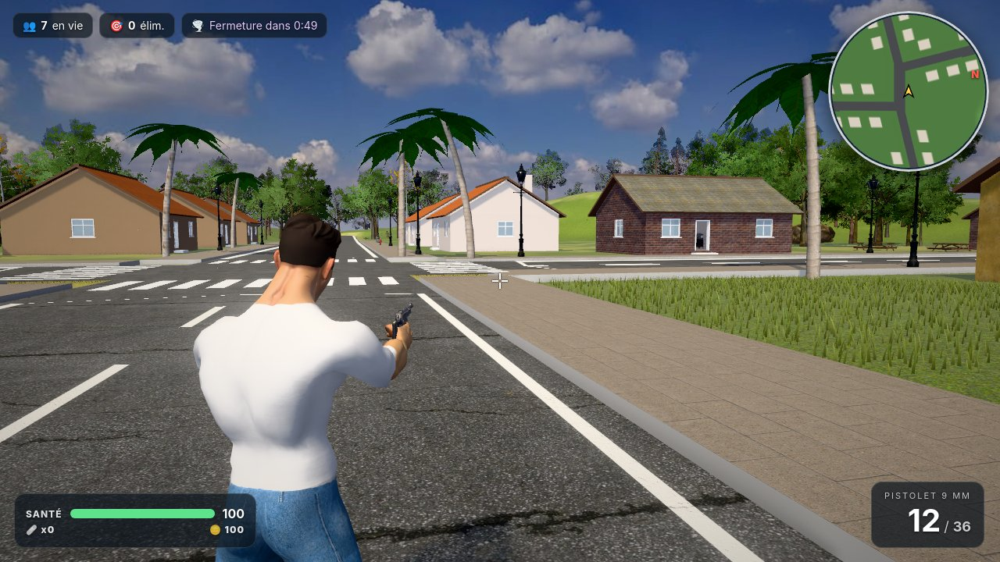
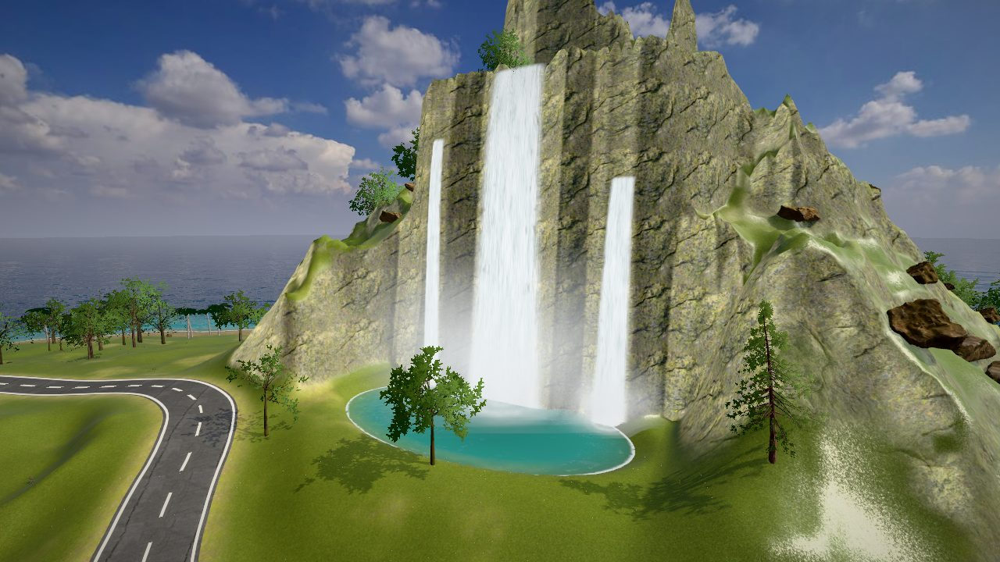
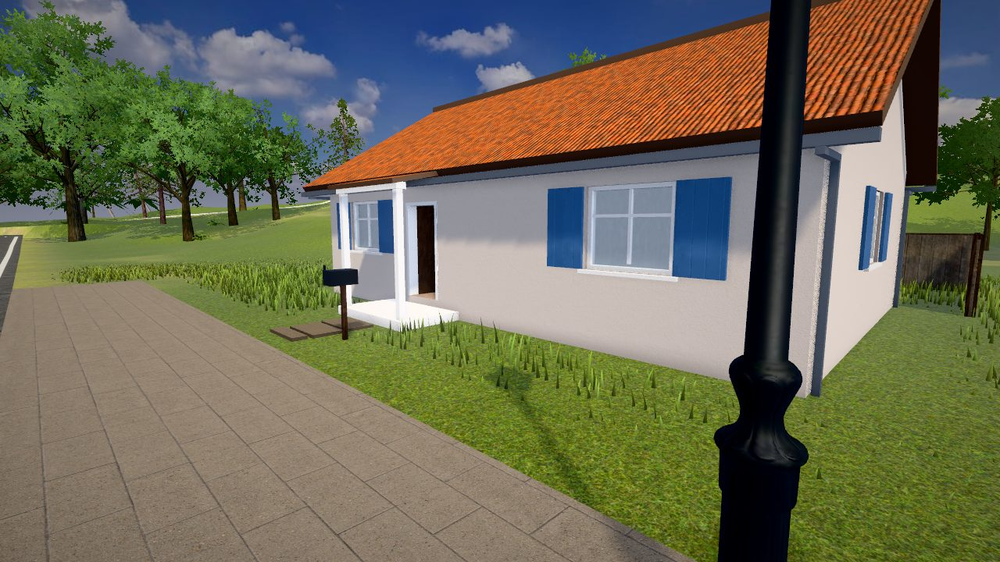
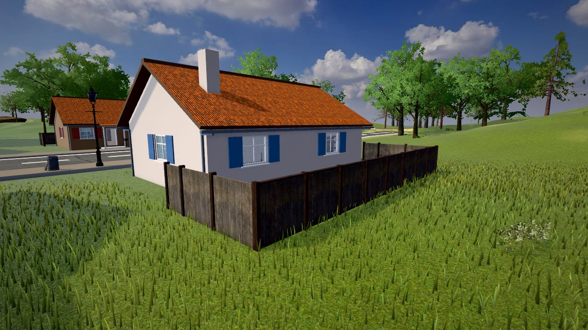
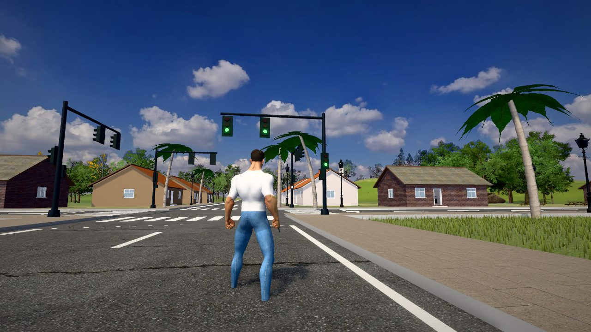
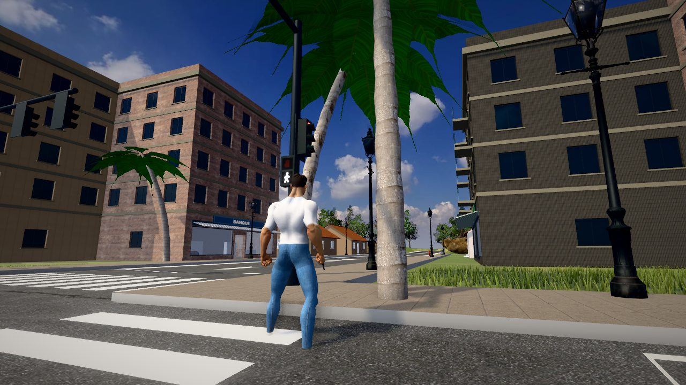

# Battle Royale — Île de San Calma

Battle Royale solo en 3D, hors ligne, avec des graphismes réalistes : textures PBR photo-scannées,
ciel HDRI, océan, personnages humains animés, maisons explorables et voitures conduisibles.
C'est la suite du prototype Python d'origine (conservé dans `prototype_python/`).









## Lancer le jeu sur Mac (double-clic)

Télécharge ou clone le dossier complet, puis **double-clique sur `Battle Royale.app`**.
C'est une vraie application Mac : le jeu s'ouvre dans sa propre fenêtre (pas de navigateur), avec son icône
dans le Dock, la souris capturée pendant la partie et le plein écran (⌘F ou bouton vert). Tout le jeu est
rangé à l'intérieur de l'application : tu peux la glisser dans ton dossier **Applications**.

La première fois, macOS peut bloquer l'application (« développeur non identifié ») car elle n'est pas signée.
Fais **clic droit → Ouvrir → Ouvrir**, une seule fois. Si macOS dit qu'elle est « endommagée » (fichier téléchargé),
retire la mise en quarantaine dans le Terminal, depuis le dossier du jeu, puis relance-la :

```bash
xattr -cr "Battle Royale.app"
```

Si le double-clic ne fait rien, rends le lanceur exécutable :

```bash
chmod +x "Battle Royale.app/Contents/MacOS/lancer"
```

En secours, `JOUER.html` ouvre le même jeu dans Safari ou Chrome.

**Configuration conseillée** : Mac Apple Silicon (M1 ou plus récent), macOS 12+, Safari 15+ ou Chrome récent.
Sur un Mac Intel, choisis la qualité « moyenne » ou « basse » dans Options. Le jeu baisse aussi la qualité
tout seul s'il passe sous ~30 images/s.

## Commandes

| Touche | Action |
|---|---|
| Z Q S D (ou W A S D) | Se déplacer, nager dans l'eau |
| Maj | Sprinter |
| Espace | Sauter |
| Souris | Regarder (clique dans le jeu pour capturer la souris) |
| Clic droit | Viser |
| Clic gauche | Tirer |
| R | Recharger |
| E | Ouvrir un coffre · monter/descendre de voiture |
| H | Trousse de soin |
| B | Danser |
| C | Marcher lentement |
| M | Carte de l'île |
| Échap | Pause |

En voiture : Z/W accélérer, S freiner/reculer, Q/A et D tourner, Espace frein à main.

## Ce qui est fait (et testé)

- **Île de 640 m × 640 m** : relief avec collines, plages, lagon, routes asphaltées avec marquage,
  village avec trottoirs, passages piétons et lampadaires.
- **Massif montagneux** : falaise de roche photo-scannée, lac d'altitude et **trois cascades** animées
  (trajectoire de chute réelle, brume, écume au pied, bassin turquoise, grondement qui augmente quand on s'approche).
  On peut nager dans les lacs.
- **Feux tricolores** aux carrefours (vert → orange → rouge, en alternance entre les deux rues) avec feux piétons.
- **Centre-ville** : immeubles de 4 à 6 étages avec boutiques au rez-de-chaussée (vitrines, enseignes, stores),
  et 4 tours d'habitation de 8 à 11 étages.
- **Sol photo-réaliste** : mélange automatique herbe / terre / sable / roche selon l'altitude et la pente, anti-répétition.
- **Herbe haute animée** par le vent (des centaines de milliers de brins générés sur la carte graphique) : brins arrondis,
  translucides à contre-jour, plaques plus sèches ou plus vertes, touffes ; arbres procéduraux animés,
  palmiers, rochers, buissons et fougères photo-scannés.
- **Océan** : couleur selon la profondeur réelle (turquoise dans le lagon), reflets du ciel et du soleil, écume.
- **Rendu** : ciel HDRI 4K, éclairage global par image, ombres douces, occlusion ambiante (GTAO), bloom, étalonnage.
- **Maisons explorables** : volets en bois peint, perron à colonnes avec auvent, gouttières et descentes,
  allée dallée, boîte aux lettres, jardin arrière clôturé ; porte ouverte, fenêtres vitrées, cloison salon/chambre, meubles réels
  (canapé, fauteuil, table basse, télé, bibliothèque, lit, table de nuit, chaise, plante), collisions sur murs et meubles.
  Aucun arbre ni rocher n'apparaît dans les maisons.
- **Personnages humains riggés** (homme / femme) avec vraies animations : repos, marche, course, sprint,
  saut (départ, chute, réception), nage, danse, conduite, visée et tir au pistolet, rechargement, impact, mort.
- **Tenues** composées de tissus scannés (jean, coton, jersey, cuir, camouflage) : 8 tenues.
- **Casier** (choix de tenue) et **boutique** (achat avec les pièces gagnées), sauvegardés dans le navigateur ;
  le menu montre ton personnage en 3D avec la tenue équipée (il danse quand tu en changes).
- **Battle royale** : 15 bots qui explorent, fouillent, fuient la tempête et se battent entre eux et contre toi ;
  tempête qui se referme en 6 phases ; coffres qui s'ouvrent (couvercle animé), trousses de soin, munitions ;
  pistolet avec chargeur, tirs à la tête, traçantes ; classement et écran de victoire.
- **Voitures conduisibles** (9) : suspension sur le relief, roues qui tournent et braquent, son moteur,
  collisions, on peut écraser les adversaires.
- **HUD** : santé, munitions, pièces, joueurs en vie, minuteur de tempête, mini-carte orientée, grande carte, fil des éliminations.
- **Sons** synthétisés (tirs, pas, ressac, vent, moteur, coffres).

### Limites connues (honnêtement)

- Les vêtements sont **peints** sur le corps (pas de vêtements 3D séparés) : de près, la tenue colle à la silhouette.
- Les bots se déplacent en ligne droite avec un évitement simple (pas de vrai calcul d'itinéraire).
- Une seule arme (pistolet). Pas de multijoueur.
- Testé automatiquement dans Chromium et dans WebKit (le moteur de Safari, le même que celui de l'application),
  en ouvrant le jeu depuis le disque. La fenêtre Mac elle-même (`Contents/Resources/app.js`, écrite en JavaScript
  for Automation, sans compilation) n'a pas pu être testée sur un vrai Mac : les performances dépendent de ta machine
  (touche **P** pour afficher les images/seconde).

## Pour les développeurs

Le jeu est écrit en JavaScript avec [Three.js](https://threejs.org) (moteur WebGL). Les sources sont dans `src/`,
compilées en un seul fichier `Battle Royale.app/Contents/Resources/jeu/js/game.js`. Les ressources sont empaquetées
dans `…/jeu/assets/*.js` (base64),
ce qui permet d'ouvrir le jeu directement depuis le disque (`file://`) sans serveur.

```bash
npm install                 # outils (Node 20+)
npm run fetch-assets        # télécharge les ressources sources dans assets_src/ (~500 Mo)
npm run build-assets        # optimise et empaquette les ressources dans l'application
npm run build               # compile src/ -> Battle Royale.app/Contents/Resources/jeu/js/game.js
npm test                    # test automatique de gameplay (nécessite Playwright + Chromium)
```

`node tests/shot.mjs "q=haute&auto&bots=4" capture.png` fait une capture d'écran d'une partie (Chromium),
`node tests/shot_webkit.mjs "q=haute&auto&bots=4" capture.png` fait de même avec WebKit (moteur de Safari).
Paramètres d'URL utiles : `q=basse|moyenne|haute|ultra`, `auto` (lance directement une partie), `bots=N`, `stats`.

| Dossier | Contenu |
|---|---|
| `src/` | Code du jeu (rendu, terrain, eau, végétation, village, personnages, IA, voitures, interface) |
| `tools/` | Pipeline des ressources (téléchargement, simplification des maillages, compression, masques de vêtements) |
| `Battle Royale.app/` | L'application Mac : lanceur (`MacOS/lancer`), fenêtre native (`Resources/app.js`), icône, jeu compilé et ressources (`Resources/jeu/`) |
| `tools/make_icon.py` | Fabrique l'icône `.icns` à partir d'une capture du jeu |
| `tests/` | Test de gameplay et captures d'écran |
| `prototype_python/` | Prototype Ursina d'origine et `reference_game.html` (conservés) |

### Pourquoi plus en Python ?

Le prototype Ursina/Panda3D ne permettait pas facilement un rendu de ce niveau (éclairage HDRI, ombres douces,
post-traitement, herbe sur GPU) et demandait d'installer Python et des bibliothèques. La version WebGL tourne
dans le moteur WebKit intégré à macOS : l'application n'a besoin de rien installer et se lance d'un double-clic.

## Crédits et licences des ressources

| Ressource | Auteur / source | Licence |
|---|---|---|
| Textures PBR (sable, roches, roche moussue, asphalte, briques, crépis, béton, façades, rideaux métalliques, tuiles, parquets, carrelage, bois, planches, écorce de palmier, tissus) | [Poly Haven](https://polyhaven.com) | CC0 |
| Ciel HDRI « Kloofendal 48d Partly Cloudy (Pure Sky) » | Poly Haven (Greg Zaal, Jarod Guest) | CC0 |
| Modèles : mobilier, lampadaires, bouche d'incendie, poubelles, barrières, coffre, trousse de soin, caisse de munitions, pistolet, rochers, buissons, fougères, souche | Poly Haven | CC0 |
| Textures d'herbe et de terre (Grass004, Ground037) | [ambientCG](https://ambientcg.com) | CC0 |
| Personnages « Universal Base Characters » + coiffures | [Quaternius](https://quaternius.com) | CC0 |
| Animations « Universal Animation Library » | Quaternius | CC0 |
| Voiture « Car Concept » | Eric Chadwick / Darmstadt Graphics Group, [Khronos glTF Sample Assets](https://github.com/KhronosGroup/glTF-Sample-Assets) | CC-BY 4.0 |
| Générateur d'arbres « EZ-Tree » (et ses textures) | Daniel Greenheck | MIT |
| Moteur 3D Three.js (et texture de normales d'eau) | three.js authors | MIT |
